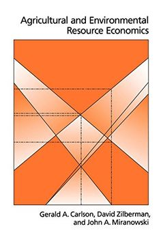
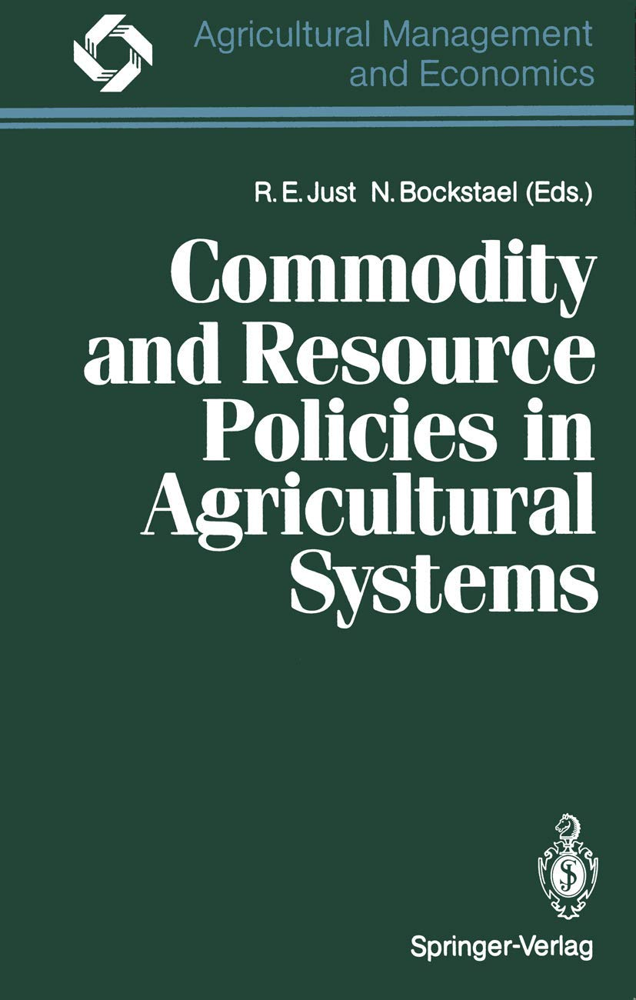
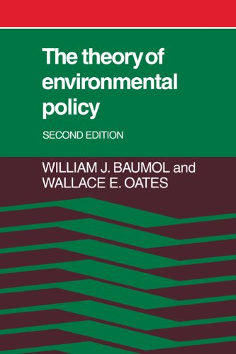

## Memorandums

:::{#blogposts}
:::

 

## R programming and Quarto

R and Quarto are my primary tools for academic research. I use them for:

+ Data wrangling and visualization with packages such as `data.table` and `ggplot2`.
+ Geospatial analysis of vector and raster data using packages such as `sf` and `terra`.
+ Integrating Python scripts and functions into R workflows using `reticulate`.
+ Creating reproducible papers, reports, and presentation slides with Quarto, including formatted tables using packages such as `flextable`, `gt`, and `modelsummary`.

**Here, I share my experience of learning R and some useful resources that helped me along the way.**

:::{#r}
:::

 

## Book Notes

<!-- The most influential books I have read are listed below, which really helped shape my understanding and approach in agricultural and environmental policy analysis. -->

::: {layout-ncol=3}
{height=1in}

{height=1in}

{height=1in}
:::

:::{#booknotes}
:::

